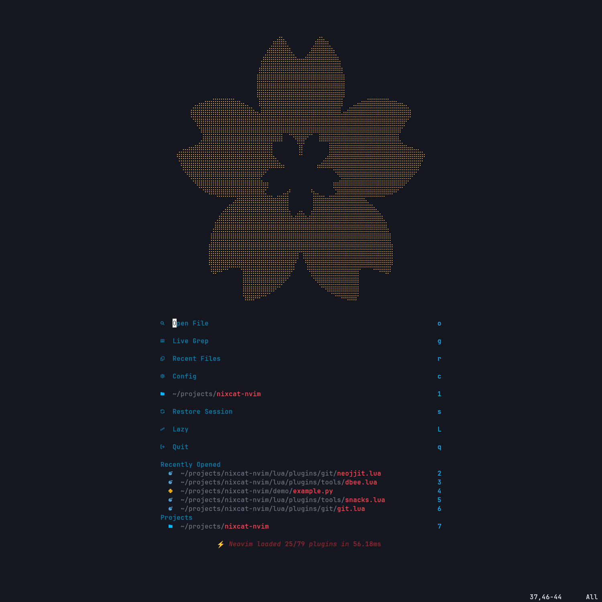
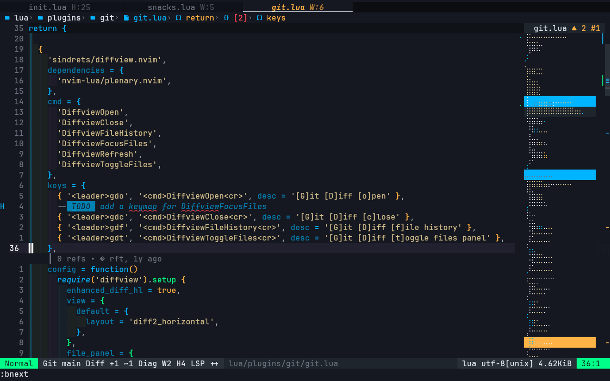

# Nano's Neovim Configuration

A not so finished Neovim configuration built with [nixCats](https://github.com/BirdeeHub/nixCats-nvim) and based on kickstart.nvim

Mostly vibecoded so do not take what I have in here seriously. Reason for being so is that if my neovim config is not on parity with vscode, I will not use it, so it's a starting point.






More screenshots are in the [Plugin Reference](docs/plugins.md).

## Quick Start

### Try Without Installing
You can try this configuration without committing to installing it:

```bash
nix run github:rft/nixcat-nvim
```

### Install

#### Nix Profile
Install imperatively with:

```bash
nix profile install github:rft/nixcat-nvim
```

#### Nix Flake Configuration
Add to your `flake.nix` inputs:

```nix
{
  inputs = {
    nixpkgs.url = "github:nixos/nixpkgs/nixpkgs-unstable";
    nano-nvim.url = "github:rft/nixcat-nvim";
  };
}
```

Then add the package to your NixOS or home-manager configuration:

```nix
{ inputs, pkgs, ... }: {
  # NixOS (configuration.nix)
  environment.systemPackages = [ inputs.nano-nvim.packages.${pkgs.system}.default ];

  # or home-manager (home.nix)
  home.packages = [ inputs.nano-nvim.packages.${pkgs.system}.default ];
}
```

#### NixOS / Home Manager Modules
If you want to change categories or settings without forking, import the
module instead of the package: `inputs.nano-nvim.nixosModules.default` or
`inputs.nano-nvim.homeModules.default`. See
[Nix Architecture](docs/nix-architecture.md#installation-methods).

### Shell Alias
If you'd like to use `nvim` to launch this configuration via `nix run`:

```bash
# Add to your .bashrc, .zshrc, etc.
alias nvim='nix run github:rft/nixcat-nvim --'
```

The `--` ensures any arguments (filenames, flags) are passed through to Neovim.

## Documentation

- **[Plugin Reference](docs/plugins.md)** - Every plugin with purpose, keybinds, config locations, and screenshots
- **[Keybind Reference](docs/keybinds.md)** - Complete keybind reference organized by category
- **[Nix Architecture](docs/nix-architecture.md)** - How nixCats, flakes, overlays, and the Lua-Nix bridge work

## Configuration Structure

```
├── flake.nix              # Inputs, plugin/tool lists, package definition, checks
├── init.lua               # Main Neovim configuration entry point
├── checks/
│   └── startup.lua        # Headless smoke test run by `nix flake check`
├── lua/
│   ├── core/
│   │   ├── keymaps.lua    # Core keybind definitions
│   │   ├── options.lua    # Neovim options and settings
│   │   └── palette.lua    # Shared colour palette
│   ├── nixCatsUtils/      # Nix-to-Lua helpers and the lazy.nvim wrapper
│   └── plugins/
│       ├── general.lua    # Core plugins (Oil, undotree, etc.)
│       ├── ui/            # Visual/display plugins
│       ├── navigation/    # Search, jump, file tree
│       ├── editing/       # Text manipulation, completion, comments
│       ├── lsp/           # Language server configuration
│       ├── git/           # Git integration
│       ├── tools/         # Debug, lint, AI, terminal, sessions
│       ├── obsidian/      # Note-taking (obsidian)
│       └── orgmode/       # Note-taking (orgmode)
```

This configuration only works when built through Nix: every plugin, LSP and
tool comes from the flake, and there is no Mason or lazy.nvim download
fallback. `git` is the one thing expected on your own `PATH`.

## Development

```bash
nix flake check          # build, headless startup test, stylua and nixfmt checks
nix fmt                  # format flake.nix
nix develop -c stylua .  # format Lua
```

## Credits

- Built on [kickstart.nvim](https://github.com/nvim-lua/kickstart.nvim)
- Powered by [nixCats](https://github.com/BirdeeHub/nixCats-nvim)
- Plugin ecosystem from the amazing Neovim community
